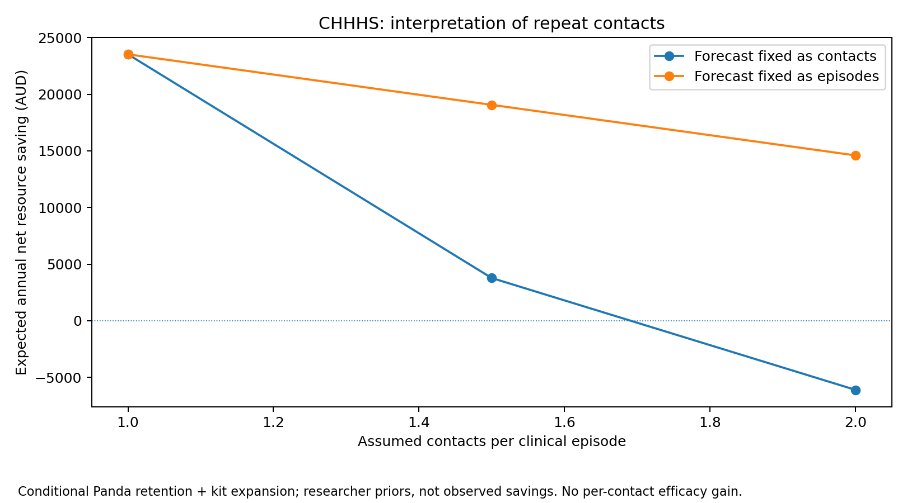
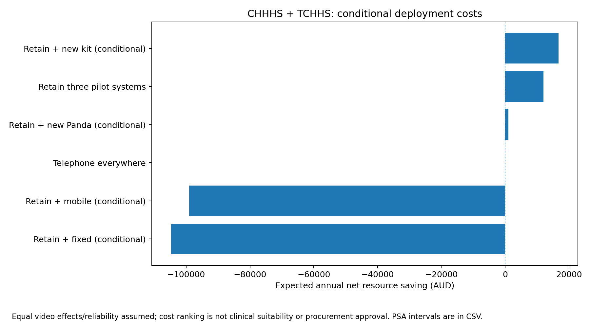
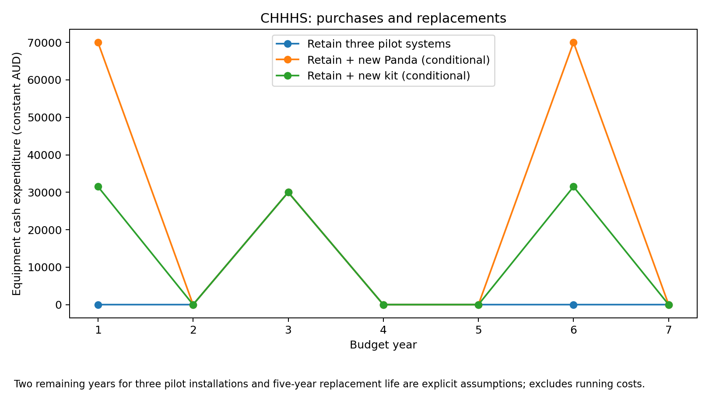

# Neocam: episode/contact and mixed-deployment refinements

This is a conditional decision-model supplement, not observed clinical or financial outcomes. The exact model uses existing evidence and disclosed analyst scenarios; it is not fitted to the Atherton pilot cases.

## Expected annual health-system resource result

Default one-contact-per-episode scenario, attenuated clinical-effect structure, retaining the three known pilot installations. Expansion options are hypothetical site-suitability scenarios. Equal video effects and reliability are assumed across configurations.

| Network | Policy | Expected net resource saving (AUD/year) | 95% researcher-prior interval | Probability of resource saving |
|---|---|---:|---|---:|
| pilot | Retain three pilot systems | 12,049 | -30,927 to 74,296 | 66.5% |
| chhhs | Retain three pilot systems | 12,049 | -30,927 to 74,296 | 66.5% |
| chhhs | Retain + new Panda (conditional) | 13,518 | -109,605 to 189,427 | 51.2% |
| chhhs | Retain + new kit (conditional) | 23,525 | -99,395 to 199,271 | 58.4% |
| chhhs | Retain + mobile (conditional) | -50,159 | -177,801 to 129,381 | 20.7% |
| chhhs | Retain + fixed (conditional) | -53,798 | -182,053 to 125,865 | 19.5% |
| chhhs_tchhs | Retain three pilot systems | 12,049 | -30,927 to 74,296 | 66.5% |
| chhhs_tchhs | Retain + new Panda (conditional) | 1,025 | -134,765 to 194,822 | 43.4% |
| chhhs_tchhs | Retain + new kit (conditional) | 16,749 | -118,514 to 210,672 | 52.4% |
| chhhs_tchhs | Retain + mobile (conditional) | -99,040 | -246,307 to 101,488 | 11.3% |
| chhhs_tchhs | Retain + fixed (conditional) | -104,758 | -253,223 to 96,411 | 10.5% |
| spokes | Retain three pilot systems | 12,049 | -30,927 to 74,296 | 66.5% |
| spokes | Retain + new Panda (conditional) | 312,105 | -819,656 to 1,920,201 | 66.2% |
| spokes | Retain + new kit (conditional) | 354,990 | -777,461 to 1,963,333 | 69.7% |
| spokes | Retain + mobile (conditional) | 39,202 | -1,097,879 to 1,653,318 | 45.5% |
| spokes | Retain + fixed (conditional) | 23,607 | -1,113,862 to 1,638,527 | 44.5% |

Net saving is against telephone. Negative values mean added resources, not proof of poor clinical value. The family extension is bounded; arbitrary policy-specific provider/Commonwealth/state allocations are not inferred. The six-perspective primary reference is retained separately.

## Repeat-contact interpretation

For a fixed forecast of contacts, repeated contacts reduce distinct clinical episodes; for a fixed forecast of episodes, repeated contacts increase workload. The ratio is not observed locally. Repeated contacts do not independently amplify clinical success or video reliability. An episode is not necessarily a unique infant across separate illnesses.

## Decision sets and equipment

Telephone everywhere and retention at the three reported pilot sites form the reported-operation set. Reported operation is not regulatory certification. New Panda, kit, mobile and fixed installations are conditional alternatives requiring site-specific capability and governance checks. Duplicate assignment policies are removed before probability-best calculations.

Hub workload is summed across technologies before applying shared paid-capacity blocks. Purchase and replacement schedules use the same owned estate as the economic calculation. Retention does not make future replacement free.

## Validation and evidence

480 paired policy/scenario evaluations each use 20,000 draws; the maximum cohort residual is 6.82e-13. These are overlapping model comparisons, not independent clinical studies. All external reviewer records are pending. Automatic arithmetic checks cannot certify clinical appropriateness; additional appropriate transfers may be beneficial.

Input and calculation-source identity: `resolved_inputs.json`. Eligibility and assignments: `eligibility.csv`, `policy_assignments.csv`. PSA and exact rankings: `policy_psa.csv`, `policy_rankings.csv`. Absolute prior-predictive outputs: `policy_predictive.csv`. Seven-year cash schedules: `policy_budget.csv`. Review requests: `review_packet.json`. Original literature, estimates, rights and gaps remain in the repository evidence/source registers; this supplement adds no empirical effect or price claim.
